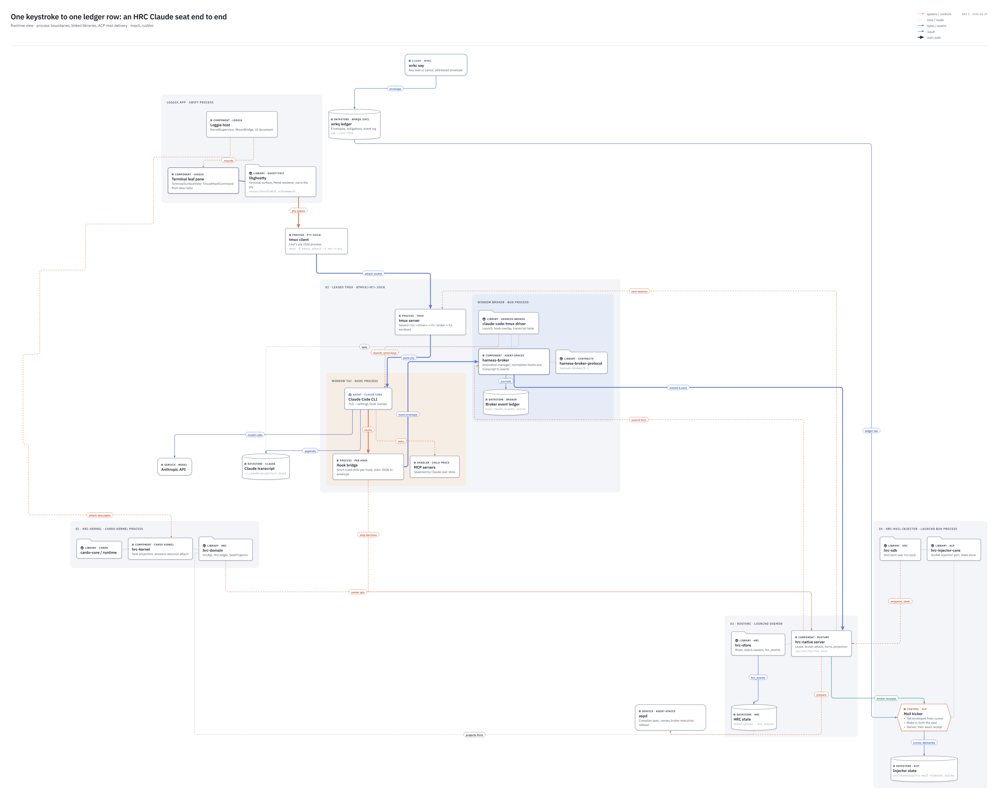

# Session runtime view: an HRC Claude seat end to end



> **Superseded for Claude seats on 2026-10-29 (T-12046, hrc-pty).** Claude seats
> whose profile selects `harness = "claude-hrcpty"` no longer run under tmux:
> a per-seat `hrc-pty` supervisor (`crates/hrc-pty`) owns the pty, Claude and
> the broker, tees output into headless libghostty-vt and relays raw bytes to
> the Loggia leaf, so Claude sees `TERM=xterm-ghostty` directly. The tmux path
> below still describes `claude-code-tmux` and the codex/pi/muse drivers. The
> hrcpty design and dispatch route: `~/praesidium/var/wrkq-artifacts/T-12046/spec.md`
> (REV 5, Daedalus-approved; invariant `hrc-runtime.hrcpty-seat-supervision`).

This is a runtime view of one HRC-managed Claude Code seat on max3 (rusthrc). It
shows every OS process from the operator's Loggia window down to the HRC ledger
row, the libraries linked into each process, and the ACP mail path that puts
a turn into the seat. Boundaries are processes, folder cards are linked
libraries, and cylinders are durable stores. The heavy line is the main path,
one keystroke to one `hrc_events` row.

This README carries enough detail to reason about and iterate on the
architecture without re-reading the code. Every claim below was read from
source on 2026-10-29 at these commits:

| repo | commit |
| --- | --- |
| hrc-runtime | `582621c7` |
| agent-spaces | `16ce4cb3` |
| agent-control-plane | `09fb037` |
| loggia | `e31b129` |

Re-verify any claim you are about to build on if those repos have moved far.

## Files

| file | what |
| --- | --- |
| `session-runtime-view.arris.json` | Editable Arris native, the source of truth for the drawing |
| `session-runtime-view.png` | 1x render of the native |

## Processes

Each row is one OS process, or a family of short-lived processes, and who
starts it.

| process | started by | lifetime | linked libraries in the view |
| --- | --- | --- | --- |
| Loggia.app (Swift) | operator | app session | libghostty (GhosttyKit.xcframework) |
| hrc-kernel (Rust, cardo kernel) | Loggia `KernelSupervisor`, from the `kernels` config key | supervised child; restarts with 0.5 s to 8 s backoff, at most 5 a minute | cardo-core, cardo-runtime, hrc-domain |
| tmux client | libghostty, as the leaf pane's pty child | while the leaf pane is open | none |
| tmux server (leased) | rusthrc (`tmux -S <runtime>/btmux/<x>.sock new-session`) | the runtime's lease | none |
| harness-broker (bun) | rusthrc, as the command of the `broker` window | the runtime | claude-code-tmux driver, harness-broker-protocol |
| Claude Code CLI (node) | broker driver, into the `tui` window that rusthrc created | the runtime | none drawn |
| Hook bridge | Claude Code, once per hook event | one hook | broker hook-bridge transport |
| MCP servers | Claude Code, over stdio | Claude's lifetime | none |
| rusthrc (`hrc-native` binary) | launchd `com.praesidium.hrc-server` | daemon | hrc-store, hrc-common, hrc-cli |
| hrc-mail-injector (bun) | launchd `com.praesidium.hrc-mail-injector` | daemon | hrc-injector-core, hrc-sdk |
| aspd | its own supervisor (not drawn) | daemon | none drawn |

## Nodes

These are the ids used in the native, so a script can address them by id.

### Loggia.app, Swift process (`loggia`)

- **`host` Loggia host.** The app shell: `KernelSupervisor`, `MacMountBridge`,
  and the UI document. It starts or attaches kernels: cardo-ui, plus each
  entry in the `kernels` config key (`loggia/Sources/Host/KernelSupervisor.swift`,
  `MacHostConfig.swift`). It asks hrc-kernel for `resource.attach` and gets
  back a `tmux-attach` descriptor.
- **`leaf` Terminal leaf pane.** `TerminalSurfaceView`. It never builds a
  tmux target itself. `TmuxAttachCommand` (`Sources/Terminal/ResourceDescriptor.swift:167`)
  validates the kernel-issued descriptor and turns it into the attach argv.
  If the target were re-derived on the Swift side, it would land on the blank
  broker window instead of the tui pane.
- **`ghostty` libghostty.** GhosttyKit.xcframework, vendored at
  `loggia/vendor/`. It provides the terminal surface and the Metal renderer,
  and it owns the pty. Its terminfo and resources must sit at
  `Contents/Resources/terminfo/78/xterm-ghostty`; if they are missing, TERM
  silently falls back to `xterm-256color`.

### hrc-kernel, cardo kernel process (`kernel`)

- **`hrckernel` hrc-kernel.** `crates/hrc-kernel`. It is an observation and
  owner-API facade kernel, supervised by Loggia (no separate resident). It
  projects seats and answers `resource.attach` with the tmux descriptor.
- **`cardo` cardo-core / cardo-runtime.** The cardo kernel framework, a
  workspace dependency.
- **`hrcdomain` hrc-domain.** `crates/hrc-domain`. It provides `HrcApi` (owner
  operations over `hrc.sock`), `HrcLedger` and `SeatProjector`. Reads project
  straight from rusthrc's native SQLite rather than through HTTP; the read
  allowlist excludes reconciling GETs.

### Between Loggia and tmux

- **`tmuxclient` tmux client.** The pty child that libghostty spawns:
  `tmux -S <runtime>/btmux/<x>.sock attach -t hrc-<driver>-<rt>:tui`.

### Leased tmux, `btmux/<rt>.sock` (`tmux`)

- **`tmuxserver` tmux server.** One private tmux server per runtime,
  created by rusthrc (`crates/hrc-native/src/server/broker/broker.rs`,
  `window()`). Session `hrc-<driver>-<runtime>`. Window `broker` is created
  with `new-session` and runs the broker command. Window `tui` is created with
  `new-window` as an empty pane, leased to the runtime (`kind: tmux-pane`,
  `ownership: hrc`, allowed ops inspect, sendInput, sendInterrupt, capture,
  resize). Server options set `focus-events on` and unbind root `M-\`. A
  headless attachable presentation gets an `observer` window instead of `tui`.

#### window broker, bun process (`brokerproc`)

- **`broker` harness-broker.** `agent-spaces/harness/harness-broker`. Its
  invocation manager accepts turns from HRC and normalizes the out-of-band
  Claude hook stream and the transcript into protocol events. It listens on
  `bipc/<leaf>/b.sock`, which is JSON-RPC over NDJSON and gated by
  `bipc/<leaf>/attach.token`, and writes stderr to `bipc/<leaf>/broker.err`.
  Per its AD-008 note, a broker invocation cannot be live-reattached or
  replayed after a restart.
- **`driver` claude-code-tmux driver.** `src/drivers/claude-code-tmux/`. It
  launches an operator-attachable interactive Claude in the tui pane and
  installs a `--settings` hook overlay that points every hook at the hook
  bridge. It delivers turns with tmux `send-keys` and tails the Claude
  transcript JSONL (`hook-transcript.ts`, `jsonl-byte-tailer.ts`).
- **`proto` harness-broker-protocol.** `agent-spaces/contracts/harness-broker-protocol`,
  at protocol version `harness-broker/0.2`. HRC's `broker.hello` checks that
  the protocol version and release identity (`releaseId`, `sourceCommit`,
  `builtAt`) match the aspd-prepared release, and refuses
  `worker_protocol_mismatch` or `worker_release_mismatch` otherwise.
- **`eventlog` Broker event ledger.** `bipc/<leaf>/events.ndjson`, the
  broker's own journal of emitted events.

#### window tui, node process (`claudeproc`)

- **`claude` Claude Code CLI.** The interactive TUI the operator sees through
  Loggia. Its hooks are configured only by the driver's `--settings` overlay.
- **`hookbridge` Hook bridge.** A short-lived child Claude spawns for each
  hook event (`UserPromptSubmit`, `PreToolUse`, `Stop`, and the rest). It
  reads the raw hook JSON on stdin and wraps it in an envelope built from the
  `HARNESS_BROKER_*` launch env, which carries the real turn id. It then
  writes the envelope to the broker's callback unix socket
  (`drivers/claude-code-tmux/hook-bridge.ts`, `drivers/hook-bridge-transport.ts`).
  On Stop it also asks **HRC directly** for a mail stop decision, at
  `/v1/internal/mail/stop-decision` and `/hint-decision` on
  `HRC_MAIL_STOP_SOCKET` (`drivers/mail-stop-gate.ts`). That call bypasses the
  broker.
- **`mcp` MCP servers.** Child processes Claude spawns over stdio.

### Outside every boundary

- **`transcript` Claude transcript.** `~/.claude/projects/*.jsonl`. Claude
  appends to it, and the driver tails it as a second event source next to
  the hooks.
- **`anthropic` Anthropic API.** Model calls.
- **`aspd` aspd.** The agent-spaces daemon. HRC asks it to prepare a runtime:
  it compiles the spec and names the execution release, which gives the
  broker executable, argv and paths. HRC records this as
  `hrc-aspd-preparation/v1` (`broker.rs`, around line 707). Births need a
  reachable aspd.
- **`sender` wrkc say.** Any seat, or Lance, sending an addressed envelope.
- **`wrkqledger` wrkq ledger.** wrkqd on svc, reached over
  `rpc://100.117.215.92:7171` (`HRC_WRKQ_DB` in the injector plist). It holds
  envelopes, obligations and the event log.

### rusthrc, launchd daemon (`hrc`)

- **`hrcd` hrc-native server.** `crates/hrc-native`, binary `rusthrc`, socket
  `var/run/hrc/hrc.sock`. It owns the tmux lease, the broker attach, turns and
  projection. It **dials into** the broker's `b.sock` (`JsonRpc::connect_broker`
  in `server/broker/rpc.rs`); events flow back over that connection. It serves
  `/v1/broker-events`, `/follow` and `/query` to consumers such as the
  injector.
- **`hrcstore` hrc-store.** `crates/hrc-store`, which owns rows, status and
  `hrc_events`.
- **`statedb` HRC state.** `state.sqlite` under the HRC state root, holding
  `hrc_events`. Locate the state root; don't assume it. `var/state/state.sqlite`
  is an empty decoy.

### hrc-mail-injector, launchd bun process (`injectorproc`)

- **`kicker` Mail kicker.** `agent-control-plane/packages/hrc-mail-injector`
  (policy in `src/policy/{wake,drive,ledger,terminal}`). It tails wrkq's
  event ledger from a persisted cursor (`policy/wake/ledger-tail.ts`), runs a
  one-time cold-start catch-up, and wakes or births the target seat. It then
  delivers the turn and waits for the broker receipt.
- **`injcore` hrc-injector-core.** `packages/hrc-injector-core`. Its socket
  injection port (`socket-injection-port.ts`) is the injector's whole HRC
  surface:
  - It declares a durable `mail` subscriber.
  - It uses `enqueue`, `steer`, `invoke`, `preempt` and `withdraw` to deliver.
  - It uses `ensureTarget`, `resolveRuntimeIntent`, `locateScope`, `getSeat`
    and `listUnbornDesignations` for placement and births.
  - It reads `watch` and `tailEvents` for lifecycle, and `followBrokerEvents`
    for receipts. A lifecycle event rings a doorbell; bursts coalesce over
    250 ms; with no doorbell, a 5 s idle poll runs.
- **`hrcsdk` hrc-sdk.** `hrc-runtime/packages/hrc-sdk`, the `HrcClient` over
  `hrc.sock`.
- **`injstate` Injector state.** `var/state/acp/hrc-mail-injector.sqlite`,
  holding the wrkq cursor and delivery rows. The live delivery tables are
  here. The hrcmail tables in HRC's `state.sqlite` are frozen copies.

## Relationships

Line kinds: **flow** means bytes or events. **control_flow** means spawns,
controls or calls. **result** is a reply that closes a loop. **dependency**
means links or reads.

| id | kind | meaning |
| --- | --- | --- |
| `host__hrckernel` | control | Loggia supervises the kernel and calls `resource.attach`; the reply is the tmux descriptor |
| `host__leaf` | control | Loggia mounts the leaf pane |
| `leaf__ghostty` | dependency | the leaf renders through a libghostty surface |
| `ghostty__tmuxclient` | control | **main**: the pty spawn of `tmux attach` |
| `tmuxclient__tmuxserver` | flow | **main**: client to server over the btmux socket |
| `tmuxserver__claude` | flow | **main**: the tui pane's pty |
| `claude__hookbridge` | control | **main**: one bridge process per hook |
| `hookbridge__broker` | flow | **main**: hook envelope to the broker callback socket |
| `broker__hrcd` | flow | **main**: events over `b.sock` (HRC is the client that dialed) |
| `hrcstore__statedb` | flow | **main**: `hrc_events` append |
| `hookbridge__hrcd` | control | mail stop or hint decision, bypassing the broker |
| `driver__claude` | control | launch into the tui pane, then deliver turns with `send-keys` |
| `driver__transcript` | dependency | the driver tails the transcript JSONL |
| `claude__transcript` | flow | Claude appends to its transcript |
| `claude__anthropic` | flow | model calls |
| `claude__mcp` | control | stdio child processes |
| `broker__eventlog` | flow | broker journal |
| `hrcd__tmuxserver` | control | `new-session` and `new-window`, plus server options |
| `hrcd__aspd` | control | prepare the execution release |
| `hrcd__broker` | control | submit turn |
| `hrcdomain__hrcd` | control | owner operations from hrc-kernel |
| `hrcdomain__statedb` | dependency | hrc-kernel projects from the native SQLite |
| `sender__wrkqledger` | flow | addressed envelope |
| `wrkqledger__kicker` | flow | ledger tail from a persisted cursor |
| `kicker__injstate` | flow | cursor and delivery rows |
| `hrcsdk__hrcd` | control | enqueue or steer, plus placement and births |
| `hrcd__kicker` | result | broker receipts (`followBrokerEvents`) close the delivery |

## The two paths, in prose

**Keystroke to ledger (the main path).** The operator types in the Loggia
leaf. libghostty writes to its pty, where the tmux client forwards the bytes
over the btmux socket to the leased tmux server. The server writes them into
the tui pane's pty, where Claude Code reads them. When Claude acts, each hook
event spawns a hook bridge, which sends an envelope to the broker. The broker
normalizes it, journals it to `events.ndjson`, and emits it on `b.sock`.
rusthrc is subscribed on that connection and appends the event to
`hrc_events` through hrc-store.

**Mail to turn.** A sender runs `wrkc say`, which writes an envelope to the
wrkq ledger on svc. The mail kicker in hrc-mail-injector sees it on its
ledger tail. Through hrc-sdk it asks rusthrc to enqueue or steer, which also
births the seat if needed. rusthrc submits the turn to the broker over
`b.sock`, and the driver types it into the tui pane with `send-keys`. rusthrc
forwards the broker's receipt back to the kicker on `followBrokerEvents`, and
the kicker records the delivery. On Stop, the hook bridge asks rusthrc
whether pending mail should hold the turn open.

## Gaps, not drawn

- **cardo-ui kernel.** Loggia also runs this second kernel, which serves its UI
  document.
- **launchd** supervising rusthrc, hrc-mail-injector, `hrc-turn-attention`
  and `hrc-viewer`. The last two are other HRC consumers on max3; I didn't
  trace their roles for this view.
- **Claude's own children:** Bash tool processes and subagents.
- **The `hrc` CLI** (`crates/hrc-cli`), the operator's way into the same
  daemon, including `hrc attach`, which attaches to a live runtime.
- **Federation.** Placement on another node, and summoning a seat whose home
  is svc or hrcdev.
- **Codex drivers.** This view covers `claude-code-tmux` only. The broker
  also carries `codex-cli-tmux`, `codex-app-server`, `codex-desktop`,
  `pi-tui-tmux`, `muse-*` and `arris-resident`.

## Iterating on the diagram

Edit the native and leave this README as prose; when they disagree, update
both together. To watch edits land live:

```bash
arris serve architecture/diagrams/session-runtime-view/session-runtime-view.arris.json --gui
```

Then edit from a script run with `arris-kernel-python`:

```python
from arris_client import Session, scenario, deliver
path = "architecture/diagrams/session-runtime-view/session-runtime-view.arris.json"
session, doc = Session.open_native(path)   # joins the live serve if one is open
A = "architecture."
with session:
    with doc.edit() as b:
        scenario.add_node(b, A + "component", "newid", name="...", kicker="COMPONENT · X",
                          body="...", boundary="hrc", caption_fit="grow")
        scenario.add_relationship(b, A + "flow", "hrcd__newid", source="hrcd", target="newid", label="...")
        scenario.unpin_all(b)
        scenario.layout(b, page="fit", direction="TB")
    deliver(doc, path, keep_previous="drafts")
```

Re-render the PNG afterwards with
`arris-kernel-render <native> architecture/diagrams/session-runtime-view/session-runtime-view.png --scale 1`.
Delete the `drafts/` and `.preview/` directories that `deliver` writes, or
leave them uncommitted.

### Layout notes

- Declare the direction as TB. Arris's auto-pick prefers LR on aspect, which
  reads wrong for a layered stack.
- The diagram-level hint `order=[["kernel","tmux","hrc","injectorproc"]]` is
  what keeps the layout tidy; it also numbers those boundary titles.
- Tier hints on boundaries measured worse. `beside` and `same_rank` are
  refused on pairs joined by a real cycle (driver to claude to hook bridge to
  broker).
- The nested window boundaries carry hand-set fills (`brokerproc`
  `#E6ECF7`, `claudeproc` `#F6EDE4`). Without them they have no visible fill.
- New source nodes, ones with no inbound edges, rank at the top. When you add
  a subsystem, give it an `order` entry or expect it to pull its edges
  across the page.
- The REV 2 state measured 24 actionable findings, mostly crossings from the
  long `attach descriptor` and `owner ops` lines.
